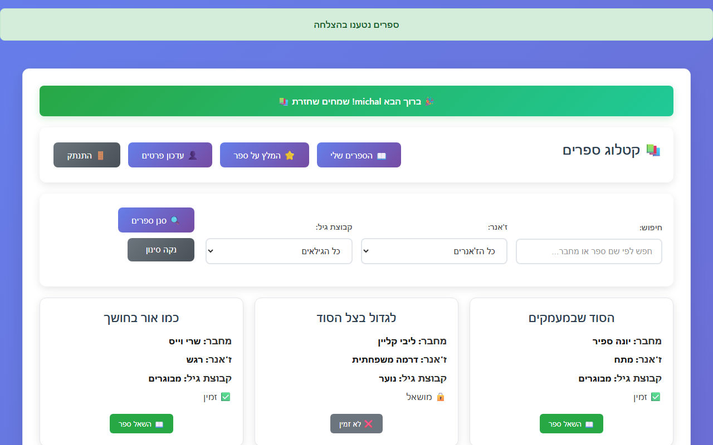
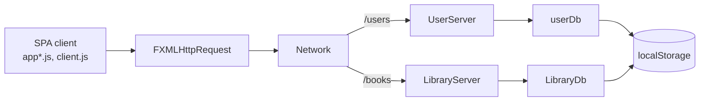

# Digital Library SPA

A Hebrew (RTL) single-page library application written in plain **JavaScript, HTML and CSS**, with no frameworks and no build step.
Members register, browse and filter the catalog, borrow and return books, and recommend new ones.

The whole **client–server architecture is simulated in the browser**: the client sends asynchronous requests through a custom `FXMLHttpRequest` class, a network layer routes them to one of two servers, and each server works with its own data layer over `localStorage`.

**Live demo:** https://chanib5331-cloud.github.io/digital-library-spa/HTML/index.html (demo user: `michal@example.com` / `1234`)


**Home**


**Catalog**


## Architecture



| Layer | File | Role |
|---|---|---|
| UI and routing | `JS/app-main.js`, `JS/app-ui.js`, `JS/app.js` | Renders HTML `<template>` pages, hash navigation and browser history, protected pages, form validation |
| Client | `JS/client.js` | Login, registration, profile update, current session |
| Request | `JS/FXMLHttpRequest.js` | Asynchronous request object modeled on `XMLHttpRequest` (`open`, `send`, `readyState`, `onreadystatechange`), with a 1–1.8 s delay |
| Network | `JS/network.js` | Routes requests by URL; a configurable failure rate simulates network errors |
| Servers | `JS/userServer.js`, `JS/libraryServer.js` | REST-style handlers with HTTP status codes |
| Data | `JS/usersDb.js`, `JS/libraryDb.js` | Data access and borrowing rules |
| Initial data | `JS/seedData.js`, `JSON/` | Loads 50 sample books and demo users on the first visit |

## API

| Method | URL | Action |
|---|---|---|
| POST | `/users/register` | Create an account |
| POST | `/users/login` | Log in |
| PUT | `/users/update/{mail}` | Update profile |
| GET | `/books/all` | All books |
| GET | `/books/filter?search=&genre=&age=` | Search and filter |
| GET | `/books/user/{mail}` | A member's borrowed books |
| POST | `/books/borrow` | Borrow a book |
| POST | `/books/recommend` | Add a recommended book |
| DELETE | `/books/return/{mail}/{bookId}` | Return a book |

**Borrowing rule:** a member may hold up to *number of children + 2* books, and a book can be borrowed by one member at a time.

## Run it

Serve the folder with any static server and open `HTML/index.html`. For example, use the VS Code **Live Server** extension, or:

```bash
npx http-server .
# then open http://localhost:8080/HTML/index.html
```

Opening the file directly (`file://`) also works, but the sample data isn't loaded.

Register a new account, or use the demo user `michal@example.com` / `1234`.

To try the network failure simulation, run `globalNetwork.setFailureRate(50)` in the browser console.

## Note

This is a learning project. Data and passwords are stored in plain text in the browser's `localStorage`, so don't enter a real password.
